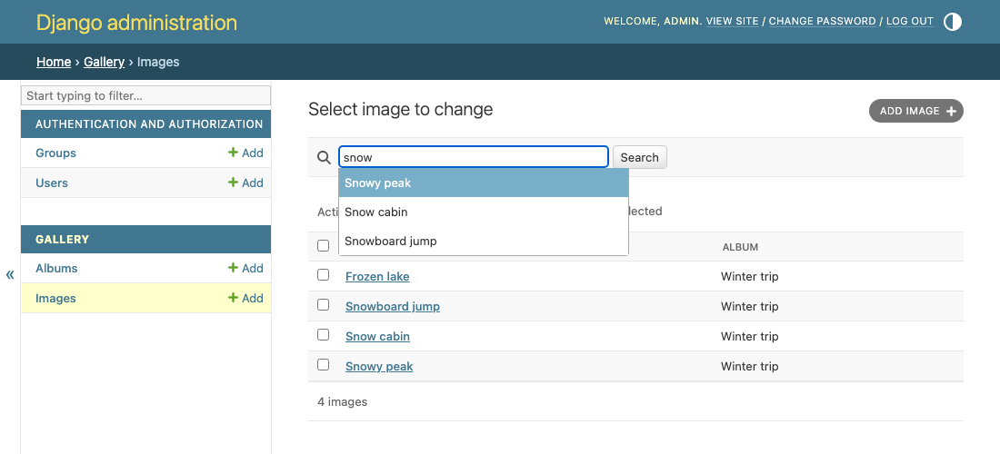
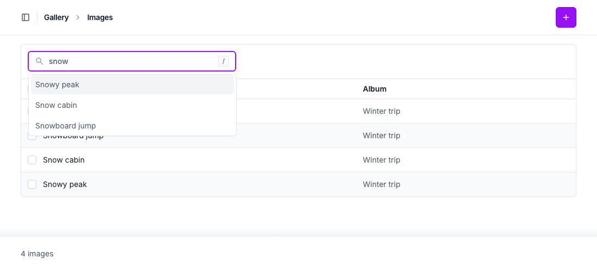
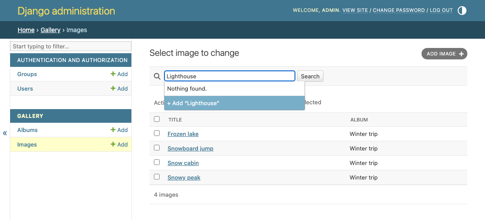
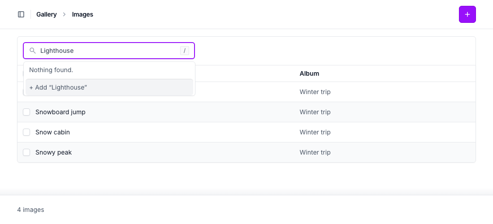
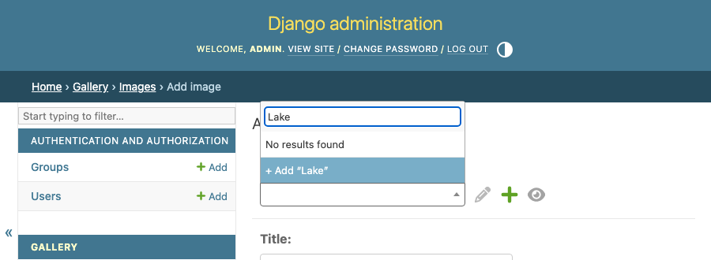
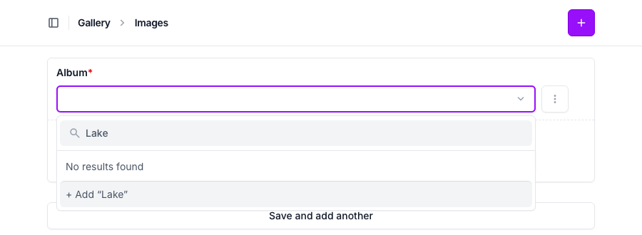
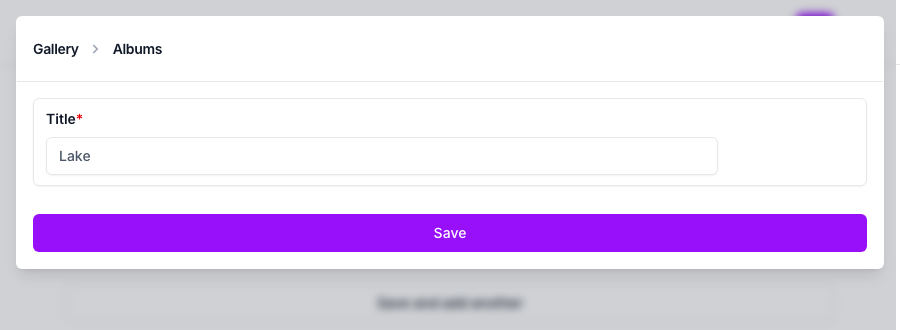

# django-admin-suggest

[](https://github.com/rodolvbg/django-admin-suggest/actions/workflows/pytest.yml)
[](https://github.com/rodolvbg/django-admin-suggest/actions/workflows/js-tests.yml)
[](https://pypi.org/project/django-admin-suggest/)
[](https://pypi.org/project/django-admin-suggest/)
[](https://pypi.org/project/django-admin-suggest/)
[](https://pepy.tech/project/django-admin-suggest)

Suggestions as one types, for the Django admin and
[django-unfold](https://github.com/unfoldadmin/django-unfold): the
changelist's search box suggests the objects it finds, opens the one
chosen, and offers to add what isn't found; an autocomplete field that
finds nothing offers to add it too.

## Install

```bash
uv add django-admin-suggest
# or
pip install django-admin-suggest
```

Add it to `INSTALLED_APPS` (so Django finds its template, and
`django.contrib.staticfiles` its JS and CSS):

```python
INSTALLED_APPS = [
    ...,
    "django_admin_suggest",
]
```

## Search suggestions

The changelist's search box suggests the objects it finds as one types;
choosing one, with the mouse or the keyboard (↑ ↓ Enter, Esc closes), opens
its change page. Enter without choosing one searches as always.

```python
from django.contrib import admin
from django_admin_suggest import SearchSuggestionsMixin


@admin.register(Image)
class ImageAdmin(SearchSuggestionsMixin, admin.ModelAdmin):
    search_fields = ("title", "album__title")
    search_suggestions = True
    search_suggestions_limit = 8  # optional (8)
    search_suggestions_min_length = 2  # optional (2)
    search_suggestions_add = True  # optional: nothing found, "+ Add “…”"

    def get_search_suggestion_label(self, request, obj):  # optional
        return f"{obj.title} · {obj.album}"
```

- The suggestions are what the changelist's search finds: its
  `get_search_results()` (`search_fields`, their `^`, `=` and `@`
  prefixes, and whatever overrides it), on `get_queryset(request)`, in the
  changelist's order, each object once.
- What it costs: one query, of `search_suggestions_limit` objects at most,
  a fraction of a second after the typing stops (an older request is
  cancelled). Use `list_select_related` or `get_queryset()` if the label
  reads a relation.
- Only for those who may view or change the objects; each suggestion leads
  to its change page (read-only, for those who may only view it).
  `get_search_suggestion_url()` changes where (None: not suggested), and
  `get_search_suggestions(request, term)` which objects.
- With `search_suggestions_add`, when nothing is found the last option is
  "+ Add “what was typed”": the add page, with it in a field — `True`: the
  first of `search_fields` that is an editable field of the model
  (`"^title"` or `"title__iexact"` count as `title`; none: the add page
  empty), or the field's name (`search_suggestions_add = "title"`). Only
  for those who may add; `get_search_suggestion_add_url(request, term)`
  changes where it leads (None: not offered).
- It looks like the admin's autocomplete fields: Select2's dropdown, on the
  admin's own stylesheets (and Unfold's), light and dark. The search box
  stays a text box: no jQuery, nor Select2's script.
- An accessible combobox (ARIA), without inline scripts (it works under a
  strict Content Security Policy). Not in a popup (where choosing an object
  picks it for a field).





With `search_suggestions_add`, when nothing is found:





## Adding from an autocomplete field

An autocomplete field (`autocomplete_fields`) that finds nothing offers to
add what was typed: "+ Add “…”", under "No results found", opens the
field's own "add" link — the admin's popup, Unfold's modal — with it in a
field of the add page; once saved, it's chosen, as the admin does.

```python
from django.contrib import admin
from django_admin_suggest import AutocompleteAddMixin


@admin.register(Appointment)
class AppointmentAdmin(AutocompleteAddMixin, admin.ModelAdmin):
    autocomplete_fields = ("patient", "room")
    autocomplete_add = True  # or the fields that offer it: ("patient",)

    def get_autocomplete_add_field(self, request, db_field):  # optional
        return "full_name"  # the patient's field what was typed goes in
```

- The field it goes in, by default: the related admin's first search
  field that is an editable field of its model (`"^name"` counts as
  `name`), or, with `SearchSuggestionsMixin`, its `search_suggestions_add`.
  None: the add page as it is.
- Only where the field has its "add" link: for those who may add one.
- Mouse or Enter. For a single or multiple field (`ForeignKey`,
  `ManyToManyField`), in the form or in its inlines (the mixin goes on the
  inline, then).
- It's the field's own link that opens it: whatever opens it (the admin's
  popup, Unfold's modal) opens it the same way.







## With other packages

The changelist keeps the template the admin would use: it's rendered with
`django_admin_suggest/change_list.html`, which extends it
(`change_list_template`, Unfold's, or another package's such as
[django-admin-tables](https://github.com/rodolvbg/django-admin-tables))
and only adds the script's configuration to `extrahead`.

## Translations

Ships a Spanish (`es`) translation.

## Supported versions

Django 4.2 – 6.1, Python 3.10+.

## Development

See [CONTRIBUTING.md](CONTRIBUTING.md) for setup, running the example
project, and the test/lint/type-check commands.
